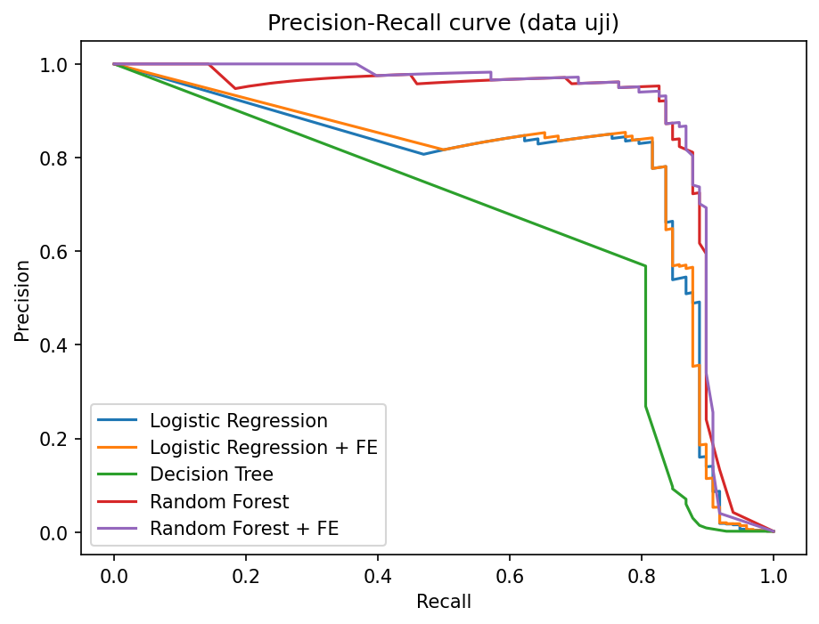
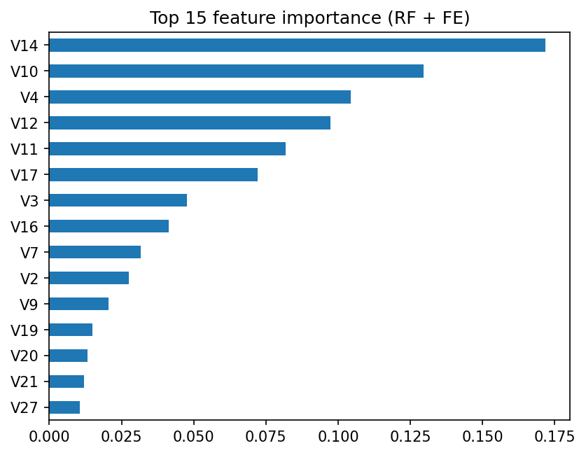

# Deteksi Transaksi Penipuan Kartu Kredit - Milestone 1 IF2116 Machine Learning

| | |
|---|---|
| **Project ID** | A11 |
| **Nama kelompok** | Kelompok Stella |
| **Kelas** | IF-A |
| **Dosen pengampu** | Al Hamidy, S.Kom., M.I.T., Ph.D. |
| **Anggota** | Dhaifan Al Ghani (231111650), Boris Sanjaya Siregar (231111783), Rasidin Harahap (231110869) |
| **Notebook (Google Colab)** | [ISI: tautan Colab final] |
| **Laporan Milestone 1** | folder `laporan/` (PDF) |

## 1. Deskripsi masalah

Proyek ini membangun model **klasifikasi biner** (supervised learning, classical machine learning) untuk memprediksi apakah suatu transaksi kartu kredit merupakan penipuan (`Class = 1`) atau transaksi normal (`Class = 0`).

- **Mengapa penting:** penipuan menimbulkan kerugian finansial dan menurunkan kepercayaan pada pembayaran digital, sedangkan pemeriksaan manual atas seluruh transaksi tidak mungkin dilakukan.
- **Tantangan utama:** data sangat tidak seimbang. Hanya 492 dari 284.807 transaksi (0,173%) yang merupakan penipuan, sehingga akurasi menyesatkan. Metrik utama adalah **PR-AUC**, dilengkapi recall, precision, F1, ROC-AUC, dan MCC.
- **Tujuan Milestone 1:** membuat baseline, melakukan EDA, menerapkan preprocessing tanpa data leakage, membandingkan model kandidat classical machine learning, dan menyusun rencana hingga UAS.
- **Batasan:** hanya fitur yang ada pada dataset, belum ada tuning hyperparameter sistematis, threshold klasifikasi masih 0,5, dan evaluasi memakai satu pembagian latih-uji. Hasilnya adalah eksperimen awal, bukan rekomendasi sistem produksi.

## 2. Dokumentasi sumber dataset

- **Nama:** Credit Card Fraud Detection
- **Pemilik:** Machine Learning Group - Universite Libre de Bruxelles (MLG-ULB), bekerja sama dengan Worldline
- **URL:** https://www.kaggle.com/datasets/mlg-ulb/creditcardfraud
- **Berkas:** `creditcard.csv`
- **Cakupan:** transaksi kartu kredit pemegang kartu Eropa selama dua hari (September 2013, menurut deskripsi dataset)
- **Cara memperoleh:** unduh dari URL di atas (perlu akun Kaggle), atau biarkan notebook mengunduh otomatis melalui `kagglehub`. Dataset **tidak disertakan** di repositori karena berukuran besar (lebih dari 100 MB); gunakan sesuai ketentuan pada halaman Kaggle.

| Aspek | Hasil pemeriksaan notebook |
|---|---|
| Jumlah observasi | 284.807 transaksi (satu baris = satu transaksi) |
| Jumlah kolom | 31: 30 fitur + 1 target |
| Tipe data | 30 kolom float64, `Class` int64 |
| Missing value | 0 |
| Baris duplikat | 1.081 (sekitar 0,38%), dipertahankan pada Milestone 1 |
| Kelas normal / fraud | 284.315 / 492 (0,173%), rasio sekitar 578 : 1 |

| Kolom | Keterangan |
|---|---|
| `Time` | Detik sejak transaksi pertama pada dataset |
| `V1` - `V28` | Komponen hasil PCA; makna aslinya dirahasiakan |
| `Amount` | Nilai transaksi |
| `Class` | Target: 1 = penipuan, 0 = normal |

## 3. Isi repositori

```
.
├── README.md                    # dokumen ini
├── requirements.txt             # daftar library dan versi
├── .gitignore                   # mengecualikan creditcard.csv
├── <notebook>.ipynb             # notebook eksperimen (dari Google Colab)
├── outputs/
│   ├── cv_results.csv           # hasil 5-fold stratified CV (data latih)
│   ├── test_results.csv         # hasil evaluasi data uji
│   └── fig_*.png                # gambar EDA, kurva PR, feature importance
└── laporan/                     # laporan Milestone 1 (PDF)
```

## 4. Petunjuk penggunaan repositori

**Google Colab (disarankan)**
1. Buka notebook melalui tautan Colab di bagian atas, atau unggah berkas `.ipynb` dari repositori ini ke Colab.
2. Pilih **Runtime lalu Run all**. Data dimuat otomatis melalui `kagglehub`; bila gagal, unggah `creditcard.csv` secara manual ketika diminta.
3. Hasil tersimpan di folder `outputs/`. Sel validasi silang memerlukan sekitar 45 menit di Colab, terutama karena Random Forest (sekitar 21-23 menit per model).

**Lokal**
```bash
pip install -r requirements.txt
jupyter notebook
```
Letakkan `creditcard.csv` di folder yang sama dengan notebook, atau ubah `DATA_PATH` pada sel konfigurasi.

**Lingkungan eksperimen:** Google Colab, Python 3.13.18, scikit-learn 1.6.1, pandas 2.2.3, numpy 2.4.6. Seluruh eksperimen memakai `random_state = 42`.

## 5. Hasil eksperimen awal

**Desain eksperimen:** split 80/20 stratified (latih 227.845 baris dengan 394 fraud; uji 56.962 baris dengan 98 fraud), RobustScaler di dalam `Pipeline` (mencegah leakage), `class_weight` untuk ketidakseimbangan kelas, validasi 5-fold stratified pada data latih, lalu evaluasi satu kali pada data uji dengan threshold 0,5. Fitur turunan yang diuji: `Amount_log` dan `Hour` (varian "+ FE").

### 5.1 Validasi silang (rata-rata ± simpangan baku, data latih)

| Model | PR-AUC | Recall | Precision | F1 | ROC-AUC | Waktu CV |
|---|---|---|---|---|---|---|
| Baseline Dummy (prior) | 0,002 ± 0,000 | 0,000 ± 0,000 | 0,000 ± 0,000 | 0,000 ± 0,000 | 0,500 ± 0,000 | 2 dtk |
| Logistic Regression | 0,757 ± 0,051 | 0,914 ± 0,023 | 0,063 ± 0,004 | 0,118 ± 0,006 | 0,983 ± 0,010 | 17 dtk |
| Logistic Regression + FE | 0,758 ± 0,052 | 0,911 ± 0,033 | 0,059 ± 0,003 | 0,111 ± 0,005 | 0,984 ± 0,010 | 18 dtk |
| Decision Tree (depth 6) | 0,508 ± 0,065 | 0,840 ± 0,032 | 0,060 ± 0,009 | 0,111 ± 0,016 | 0,885 ± 0,030 | 1 mnt |
| Random Forest | 0,842 ± 0,019 | 0,744 ± 0,039 | 0,947 ± 0,029 | 0,832 ± 0,019 | 0,957 ± 0,015 | 23 mnt |
| Random Forest + FE | 0,844 ± 0,028 | 0,736 ± 0,037 | 0,946 ± 0,027 | 0,827 ± 0,016 | 0,957 ± 0,017 | 21 mnt |

Sumber: `outputs/cv_results.csv`.

### 5.2 Data uji (threshold 0,5)

| Model | PR-AUC | ROC-AUC | Precision | Recall | F1 | MCC | TP | FP | FN | TN |
|---|---|---|---|---|---|---|---|---|---|---|
| Baseline Dummy (prior) | 0,002 | 0,500 | 0,000 | 0,000 | 0,000 | 0,000 | 0 | 0 | 98 | 56864 |
| Logistic Regression | 0,717 | 0,972 | 0,061 | 0,918 | 0,114 | 0,233 | 90 | 1388 | 8 | 55476 |
| Logistic Regression + FE | 0,723 | 0,973 | 0,057 | 0,908 | 0,106 | 0,223 | 89 | 1486 | 9 | 55378 |
| Decision Tree (depth 6) | 0,464 | 0,912 | 0,060 | 0,867 | 0,112 | 0,224 | 85 | 1338 | 13 | 55526 |
| Random Forest | 0,862 | 0,968 | 0,962 | 0,765 | 0,852 | 0,858 | 75 | 3 | 23 | 56861 |
| Random Forest + FE | 0,875 | 0,957 | 0,961 | 0,745 | 0,839 | 0,846 | 73 | 3 | 25 | 56861 |

Sumber: `outputs/test_results.csv`.





### 5.3 Temuan utama

- **Random Forest tanpa fitur tambahan** dipilih sebagai kandidat utama: PR-AUC validasi silang 0,842; pada data uji precision 0,962 dan recall 0,765 (75 dari 98 fraud tertangkap, 3 alarm palsu). Ini bukan model final.
- **Logistic Regression** menangkap lebih banyak fraud (recall 0,918) tetapi precision hanya 0,061 dengan 1.388 alarm palsu, sehingga beban pemeriksaan manual jauh lebih besar.
- **Fitur turunan** `Amount_log` dan `Hour` tidak memberi peningkatan berarti; selisih PR-AUC validasi silang jauh di bawah simpangan baku antar fold.
- **Fitur paling berperan** menurut Random Forest: V14, V10, V4, V12, V11, dan V17.

### 5.4 Keterbatasan

Data uji hanya memuat 98 fraud, evaluasi memakai satu pembagian, threshold belum disetel, 1.081 baris duplikat belum dihapus, dan pembagian acak mengabaikan urutan waktu. Rincian dan analisis lengkap ada di laporan.

## 6. Rencana setelah UTS

Hyperparameter tuning, threshold tuning dari prediksi out-of-fold, uji resampling di dalam pipeline, model classical tambahan, evaluasi lebih kuat (repeated stratified CV, pembagian berbasis waktu, uji penghapusan duplikat), dan penyusunan laporan akhir.

## 7. File pendukung

`requirements.txt` (versi library), `outputs/` (tabel hasil dan gambar), `.gitignore`, dan folder `laporan/` (laporan PDF). Semua angka pada README dan laporan bersumber dari notebook dan berkas CSV di `outputs/`.
